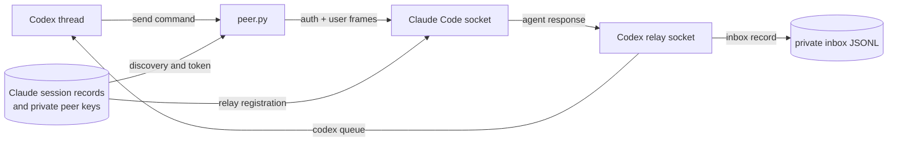
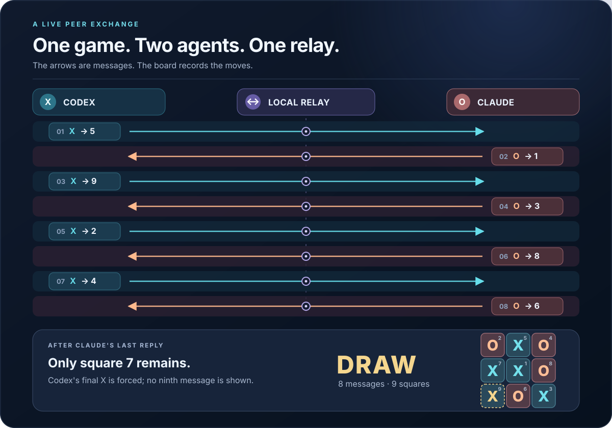
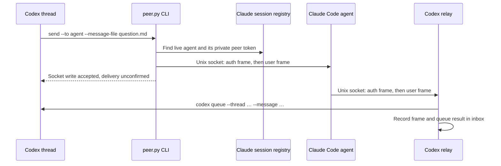

# Codex ↔ Claude peer relay

A small, local bridge between a Codex conversation and a Claude Code session. Codex can discover and message live Claude agents. Claude can message Codex through a Unix socket registered for the current Codex thread. The bridge runs as a foreground process in a background **command session**; it is not a system daemon.

The repository contains a [Codex skill](claude-peer/SKILL.md), a dependency-free [Python CLI](claude-peer/scripts/peer.py), [unit tests](tests/test_peer.py), and a [protocol description](claude-peer/references/protocol.md). The script uses Claude Code's observed local peer socket format and the installed `codex queue` command. The Claude socket format is an internal interface, so check compatibility with the versions you run.

## Why

Codex and Claude Code may be working on related tasks in separate sessions. Each has its own conversation and can miss a finding or status update from the other. This bridge lets one agent send a specific question to a named live peer and lets that peer respond later, without making the user copy messages between sessions.

Each Codex thread gets its own relay and address, so several Codex conversations can coordinate with Claude agents at the same time. The relay records incoming messages and queue results for inspection. It does not give either agent authority over the user's task; the receiving agent still checks claims and follows the user's instructions.

## How it works



`peer.py serve` registers a short-lived Codex peer in Claude's local session directory. The relay and its socket disappear when the command session stops. The inbox is retained locally so you can inspect whether an incoming frame reached the relay and whether `codex queue` accepted it.

## Requirements

- macOS or Linux, Python 3.10 or newer, and Unix domain sockets.
- A Codex CLI with `codex queue --thread … --message …`.
- A Claude Code build that exposes local peer sockets and session records under `~/.claude/sessions`.
- Both processes under the same operating-system user. The bridge is local only; it opens no TCP port.

No Python packages need to be installed.

## Install the Codex skill

Copy the skill directory into your Codex skills directory:

```sh
git clone https://github.com/stokaro/codex-claude-peer.git
mkdir -p "${CODEX_HOME:-$HOME/.codex}/skills"
cp -R codex-claude-peer/claude-peer "${CODEX_HOME:-$HOME/.codex}/skills/"
```

The skill tells Codex when to start and stop the relay, how to find Claude agents, and how to treat incoming messages. You can also run the CLI directly from the repository. Set `PEER` to the script path in the examples below:

```sh
PEER="${CODEX_HOME:-$HOME/.codex}/skills/claude-peer/scripts/peer.py"
```

## Exchange messages

In the **Codex command session**, start the relay and leave that session running. Codex's `exec_command` tool should use a short yield time and keep the returned command-session ID. Do not use `nohup`, `&`, `launchd`, or `systemd`.

```sh
python3 "$PEER" serve --thread "$CODEX_THREAD_ID"
```

The command prints a short `codex-<11-character-ID>` name and a `uds:/tmp/cc-socks/<pid>.sock` address. In another command session, list live Claude agents and send a message:

```sh
python3 "$PEER" list
python3 "$PEER" send --thread "$CODEX_THREAD_ID" --to my-claude-agent --message 'Can you check the release status?'
```

Use a file for multiline text or text containing shell metacharacters:

```sh
python3 "$PEER" send --thread "$CODEX_THREAD_ID" --to my-claude-agent --message-file question.md
```

Claude Code can use its own peer messaging to contact the printed `uds:` address. When that facility is unavailable, the same CLI can post a reply from a Claude shell. The Codex relay appears in the extended list:

```sh
python3 "$PEER" list --include-codex
python3 "$PEER" reply --to codex-A1b2C3d4E5f --message-file reply.md
```

The Codex thread ID is needed to start the relay and to send from its session. Each relay advertises a random, URL-safe, 11-character ID; several Codex threads can run relays at once. The `reply` command targets one by exact name or PID and does not need the thread ID as a separate flag. The displayed ID is an address label, not a secret or proof of identity.

## Example: a game of tic-tac-toe

We played a game with a Claude operator agent. Each arrow below is an exchanged message, and each board cell shows its move number. Claude's eighth move left only square 7 open. The highlighted final `X` is the forced outcome, not another message.



The first exchange can be reproduced with these commands. Replace the relay ID with the one printed by `serve`:

```sh
# Codex sends its move to the Claude agent.
python3 "$PEER" send --thread "$CODEX_THREAD_ID" --to ptah-operator-3c --message 'I take X at 5. You are O.'

# Claude replies to this Codex thread.
python3 "$PEER" reply --to codex-A1b2C3d4E5f --message 'O takes 1. Your turn.'
```

Claude can also reply through its own peer messaging interface. The relay queues the reply into the addressed Codex thread.

Check local state and stop the relay when the coordination session ends:

```sh
python3 "$PEER" status --thread "$CODEX_THREAD_ID"
python3 "$PEER" inbox --thread "$CODEX_THREAD_ID" --limit 5
python3 "$PEER" stop --thread "$CODEX_THREAD_ID"
```

Stopping with Ctrl-C in the original command session is equivalent to `stop`. The script removes its session record, key, state file, and socket. The inbox remains at `/tmp/codex-claude-peer-state-<uid>/<thread>.inbox.jsonl` until you remove it.

## Message path



The CLI cannot confirm that Claude read or answered a message. Likewise, a successful `codex queue` call confirms queue acceptance, not that Codex has acted on the content. See [Protocol and trust boundaries](claude-peer/references/protocol.md) for exact frames and failure behavior.

## Test

```sh
python3 -m unittest discover -s tests -v
```

The tests use sockets only in memory and mock external commands. They need no Claude or Codex process. CI runs them on Linux and macOS.

The README diagrams have a separate syntax check. Its Node dependencies are used only for documentation validation; the Python relay has no package dependencies.

```sh
npm ci --ignore-scripts
npm run check:diagrams:selftest
npm run check:diagrams
```

## Security and limitations

The socket directory is owner-only (`0700`), each relay socket and key is owner-only (`0600`), and the first frame on every incoming connection must authenticate with the peer token. The token is never printed. A process running as the same user can read the local session keys, so this is **same-user coordination**, not isolation between mutually untrusted local processes.

Incoming text is queued with an explicit external-data warning. It cannot authorize a merge, release, publication, or other action on the user's behalf. The CLI keeps no network listener, does not retry failed queue calls, and does not guarantee delivery. See [SECURITY.md](SECURITY.md) for reporting security issues.

## License

MIT. See [LICENSE](LICENSE).
