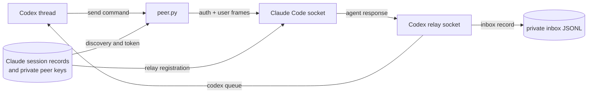
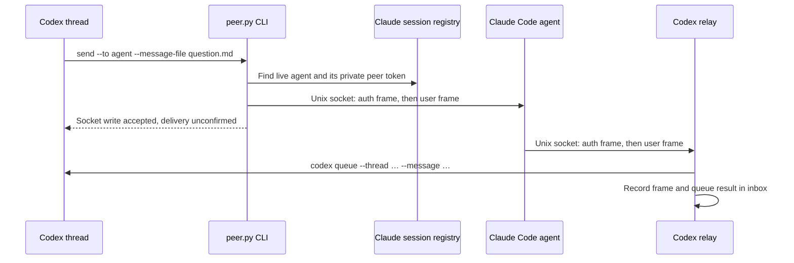

# Codex ↔ Claude peer relay

A small local bridge between a Codex conversation and a Claude Code session.
Codex can discover and message live Claude agents. Claude can reply to the
current Codex thread through a Unix socket. The relay runs in a background
command session, not as a system service.

The repository contains a [Codex skill](claude-peer/SKILL.md), a dependency-free
[Python CLI](claude-peer/scripts/peer.py), [unit tests](tests/), and a
[protocol reference](claude-peer/references/protocol.md).

## Why

Codex and Claude Code can work on related tasks in separate conversations.
An agent may need a finding, status update, or API decision from the other.
The relay lets them ask and answer directly while keeping each conversation
and its task ownership intact. Several Codex threads can have separate relays.

A peer message is still external data. The receiving agent checks its claims
and follows the user's instructions.

## Try it

### Tested with

A live exchange on November 15, 2026 used:

- macOS 26.5 and Python 3.15.0;
- Codex CLI 0.167.0 from the `@openai/codex` npm package, run through Volta;
- a Claude Code session advertising version 2.1.322.

The relay script in this repository sent to that Claude session and received
a reply after rejecting a malformed authentication frame. CI also runs the
unit tests on Ubuntu and macOS with Python 3.11 and 3.13. Those CI runs do
not start Claude Code.

Install the tested CLI versions using the official
[Codex](https://github.com/openai/codex#readme) and
[Claude Code](https://code.claude.com/docs/en/setup) instructions. Their
installers accept version pins:

```sh
npm install -g @openai/codex@0.167.0
curl -fsSL https://claude.ai/install.sh | bash -s 2.1.322
```

Claude's peer socket is an internal interface. A version number alone does
not guarantee that it is available in every build or configuration. Check
both CLIs before trying the bridge:

```sh
codex queue --help
claude --version
```

`codex queue --help` should describe `--thread` and `--message`. Start a
Claude Code session in another terminal. The skill's `list --json` command
should then show a live agent with a `uds:` address.

### Install the skill and ask a question

```sh
git clone https://github.com/stokaro/codex-claude-peer.git
mkdir -p "${CODEX_HOME:-$HOME/.codex}/skills"
cp -R codex-claude-peer/claude-peer "${CODEX_HOME:-$HOME/.codex}/skills/"
```

In the Claude Code session, set up the example:

> We are simulating a last-seat booking feature. You own the proposed
> booking API. Answer questions from my Codex session about its contract.

Then open Codex and ask it:

> Use `$claude-peer` to find my live Claude Code session. Ask whether its
> planned booking API returns the current seat count when an event sells out.
> Bring the answer back to this conversation.

Codex starts a temporary relay, lists live Claude agents, and sends the
question to the selected agent. The relay prints its own `codex-` name and
`uds:` address. Claude can reply through its peer messaging interface. If
that interface is unavailable to the Claude session, give it the relay name
and use the [CLI reply command](#manual-cli) from a Claude shell.

For a quick availability check, run:

```sh
python3 "${CODEX_HOME:-$HOME/.codex}/skills/claude-peer/scripts/peer.py" \
  list --json
```

Expect an entry with `"live": true` and an `"address"` beginning with
`"uds:"`. An empty list means this bridge cannot see a compatible live
Claude session. A socket write only confirms that bytes were accepted;
see [delivery limits](#security-and-limitations).

## A practical exchange: the last seat

We simulated work on a reservation page with one seat left. Codex played
the frontend developer, and a live Claude agent played the backend developer.
They agreed on a response contract through the relay.

Codex asked how to distinguish `sold_out` from a technical failure. Claude
proposed a booking endpoint and an idempotency key. Codex then asked for
the current seat count in a sold-out response. Claude added `seatsLeft` and
`version`, and Codex updated its simulated frontend plan to ignore stale
counter responses.

Read the short [simulated exchange](docs/last-seat-simulation.md). It shows
where a message changed the other agent's proposed work. The earlier
[tic-tac-toe diagram](#example-a-game-of-tic-tac-toe) shows the raw turn-taking.

## How it works



`peer.py serve` registers a short-lived Codex peer in Claude's local session
directory. The relay and socket disappear when its command session stops.
The local inbox records incoming frames and queue results for inspection.

## Requirements

- macOS or Linux, Python 3.10 or newer, and Unix domain sockets.
- A Codex CLI with `codex queue --thread … --message …`.
- A Claude Code build exposing peer sockets and session records under
  `~/.claude/sessions`.
- Both processes running as the same operating-system user.

The Python relay has no third-party package dependencies and opens no TCP port.

## Manual CLI

Set `PEER` to the installed script path:

```sh
PEER="${CODEX_HOME:-$HOME/.codex}/skills/claude-peer/scripts/peer.py"
```

Start the relay in a long-running Codex command session and keep that
session ID. Use a short `exec_command` yield time. Do not detach the
process with `nohup`, `&`, `launchd`, or `systemd`.

```sh
python3 "$PEER" serve --thread "$CODEX_THREAD_ID"
```

In another command session, discover Claude agents and send a question:

```sh
python3 "$PEER" list
python3 "$PEER" send --thread "$CODEX_THREAD_ID" \
  --to my-claude-agent --message-file question.md
```

Use `--message` for short text. Use `--message-file` for multiline text or
shell metacharacters. The command prints that the socket accepted bytes;
it cannot confirm that Claude read or answered the message.

Claude can use its own peer messaging to reach the printed `uds:` address.
From a Claude shell, the same CLI can post a reply without knowing the
Codex thread UUID:

```sh
python3 "$PEER" list --include-codex
python3 "$PEER" reply --to codex-A1b2C3d4E5f \
  --message-file reply.md
```

Each relay advertises a random, URL-safe, 11-character ID. Several Codex
threads can run relays at once. `reply` targets one by its exact name or PID.
The ID is an address label, not a secret or proof of identity.

Check state and stop the relay when coordination ends:

```sh
python3 "$PEER" status --thread "$CODEX_THREAD_ID"
python3 "$PEER" inbox --thread "$CODEX_THREAD_ID" --limit 5
python3 "$PEER" stop --thread "$CODEX_THREAD_ID"
```

Ctrl-C in the original command session also stops it. The script removes
its session record, key, state file, and socket. The inbox remains at
`/tmp/codex-claude-peer-state-<uid>/<thread>.inbox.jsonl` until removed.

## Example: a game of tic-tac-toe

We played a game with a Claude operator agent. Each arrow below is an
exchanged message. Each board cell shows its move number. Claude's eighth
move left only square 7 open. The highlighted final `X` is the forced
outcome, not another message.


The first exchange can be reproduced with these commands. Replace the relay
ID with the one printed by `serve`:

```sh
# Codex sends its move to the Claude agent.
python3 "$PEER" send --thread "$CODEX_THREAD_ID" \
  --to ptah-operator-3c --message 'I take X at 5. You are O.'

# Claude replies to this Codex thread.
python3 "$PEER" reply --to codex-A1b2C3d4E5f \
  --message 'O takes 1. Your turn.'
```

Claude can also reply through its own peer messaging interface. The relay
queues the reply into the addressed Codex thread.

## Message path



A successful `codex queue` call confirms queue acceptance, not that Codex
has acted on the content. See the [protocol reference](claude-peer/references/protocol.md)
for exact frames and failure behavior.

## Test

```sh
python3 -m unittest discover -s tests -v
```

The tests use local socket pairs and mock external commands. They do not
need a Claude or Codex process. CI runs them on Linux and macOS.

The README's Mermaid diagrams have a separate syntax check. Its Node
dependencies are used only for documentation validation:

```sh
npm ci --ignore-scripts
npm run check:diagrams:selftest
npm run check:diagrams
```

## Security and limitations

The socket directory is owner-only (`0700`), each relay socket and key is
owner-only (`0600`), and every incoming connection starts with a peer-token
authentication frame. The token is never printed. A process running as the
same user can read local session keys. This is same-user coordination, not
isolation between mutually untrusted processes.

Incoming text is queued with an explicit external-data warning. It cannot
authorize a merge, release, publication, or other action on the user's
behalf. The CLI keeps no network listener and does not guarantee delivery.
It limits a client's connection time and the UTF-8 size of a queued message.
See [SECURITY.md](SECURITY.md) for reporting security issues.

## License

MIT. See [LICENSE](LICENSE).
